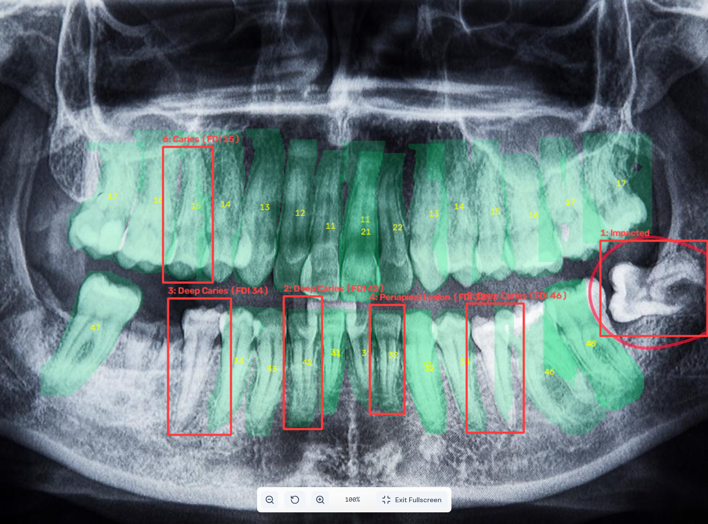
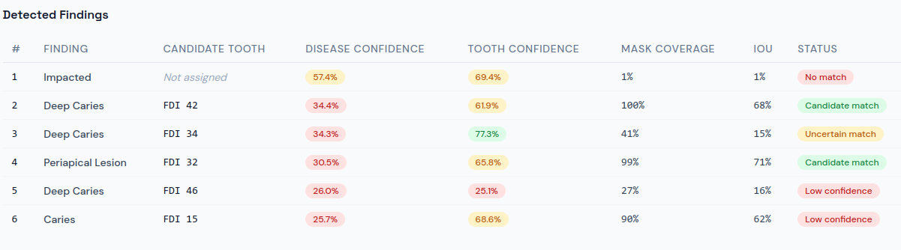

# Dental X-ray Analysis

A web application for panoramic dental X-ray analysis using YOLO-based tooth segmentation and disease detection.

**Disclaimer:** This project is intended for research and educational purposes only. It is not clinically validated and must not be used as the sole basis for diagnosis or treatment decisions.

## Features

- **Tooth Segmentation:** Segments teeth and identifies 32 permanent tooth classes using FDI numbering (11–48).
- **Disease Detection:** Detects Caries, Deep Caries, Periapical Lesion, and Impacted teeth.
- **Image Enhancement:** Uses CLAHE to improve X-ray contrast.
- **Geometric Matching:** Associates disease detections with candidate teeth.
- **Interactive Viewer:** View original, enhanced, segmented, and combined images with zoom, pan, and fullscreen controls.
- **Findings Dashboard:** Displays disease confidence, tooth confidence, mask coverage, IoU, and matching status.
- **PDF Reports:** Generates downloadable reports of analysis results.

## Screenshots

### X-ray Analysis

Shows tooth segmentation, FDI numbering, and detected dental conditions.



### Detected Findings

Displays detected conditions, candidate teeth, confidence scores, mask coverage, IoU, and matching status.



## Tech Stack

- **Frontend:** React, TypeScript, Vite, Tailwind CSS
- **Backend:** Python, Flask
- **Object Detection and Segmentation:** Ultralytics YOLO
- **Image Processing:** OpenCV
- **PDF Generation:** ReportLab

## Project Structure

```text
dental-xray-analysis/
├── assets/
│   ├── xray-analysis.png
│   └── detected-findings.png
├── backend/
│   ├── app.py
│   └── requirements.txt
├── frontend/
│   ├── src/
│   ├── package.json
│   └── vite.config.ts
├── models/
│   ├── tooth-segmentation.pt
│   └── dental-disease.pt
├── src/
│   └── pipeline.py
└── README.md
```

*Note: The structure above is illustrative. Actual file locations may differ depending on the repository version.*

## Models

| Model | Task | Source |
|---|---|---|
| `tooth-segmentation.pt` | Tooth segmentation and 32-class FDI numbering (11–48) | Custom-trained model. See the [DENTEX dataset](https://dentex.grand-challenge.org/) if used during training. |
| `dental-disease.pt` | Caries, Deep Caries, Periapical Lesion, and Impacted teeth | [Hugging Face — Caries Detection Weights](https://huggingface.co/chemahc94/caries-detection-weights) |

Both model files must be available at the paths expected by the application. Check the project configuration for the exact paths and filenames.

**Dataset reference:** [DENTEX Challenge](https://dentex.grand-challenge.org/)  
**DENTEX repository:** [GitHub — DENTEX](https://github.com/ibrahimethemhamamci/DENTEX)

## Prerequisites

- Python 3.10 or 3.11 recommended
- Node.js 18 or newer
- npm

## Installation

Clone the repository:

```bash
git clone https://github.com/bit-wo/dental-xray-analysis.git
cd dental-xray-analysis
```

### Backend Setup

Create and activate a virtual environment:

```bash
cd backend
python3 -m venv .venv
source .venv/bin/activate
pip install -r requirements.txt
```

Keep this terminal open with the virtual environment activated.

### Frontend Setup

Open a second terminal and navigate to the repository:

```bash
cd ~/dental-xray-app/frontend
npm install
```

If you cloned the repository elsewhere, replace the path with your actual project directory.

## Run the Application

### Start the Backend

From the `backend/` directory, activate the virtual environment if necessary and start Flask:

```bash
cd ~/dental-xray-app/backend
source .venv/bin/activate
python app.py
```

### Start the Frontend

In a second terminal:

```bash
cd ~/dental-xray-app/frontend
npm run dev
```

Open the frontend in your browser:

**http://localhost:5173**

The backend is expected to run at **http://localhost:5000**.

If your project uses different ports or startup commands, follow the configuration in `backend/app.py` and `frontend/package.json`.

## API Endpoints

| Method | Endpoint | Purpose |
|---|---|---|
| GET | `/api/health` | Check backend health and model status |
| POST | `/api/analyze` | Analyze an uploaded X-ray |
| GET | `/api/images/<filename>` | Retrieve generated analysis images |
| POST | `/api/report` | Generate a PDF report |

## Limitations

- Predictions and tooth numbering may be incorrect.
- Confidence scores do not represent diagnostic certainty.
- Tooth-to-disease matching is experimental.
- Performance depends on image quality and the training data.
- The system has not been clinically validated.
- Results should be reviewed by qualified dental professionals.

## References

- [Ultralytics YOLO](https://github.com/ultralytics/ultralytics)
- [DENTEX Challenge](https://dentex.grand-challenge.org/)
- [DENTEX GitHub Repository](https://github.com/ibrahimethemhamamci/DENTEX)
- [Hugging Face — Caries Detection Weights](https://huggingface.co/chemahc94/caries-detection-weights)
- [Flask Documentation](https://flask.palletsprojects.com/)
- [React Documentation](https://react.dev/)
